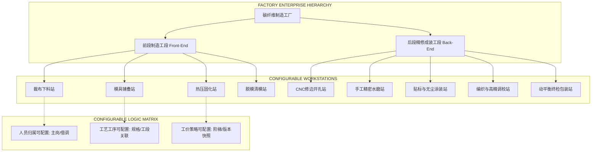
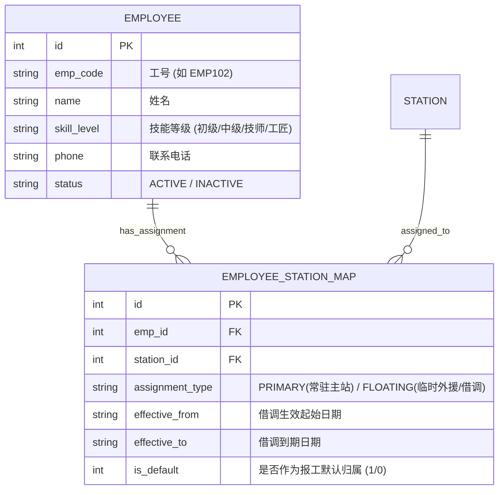
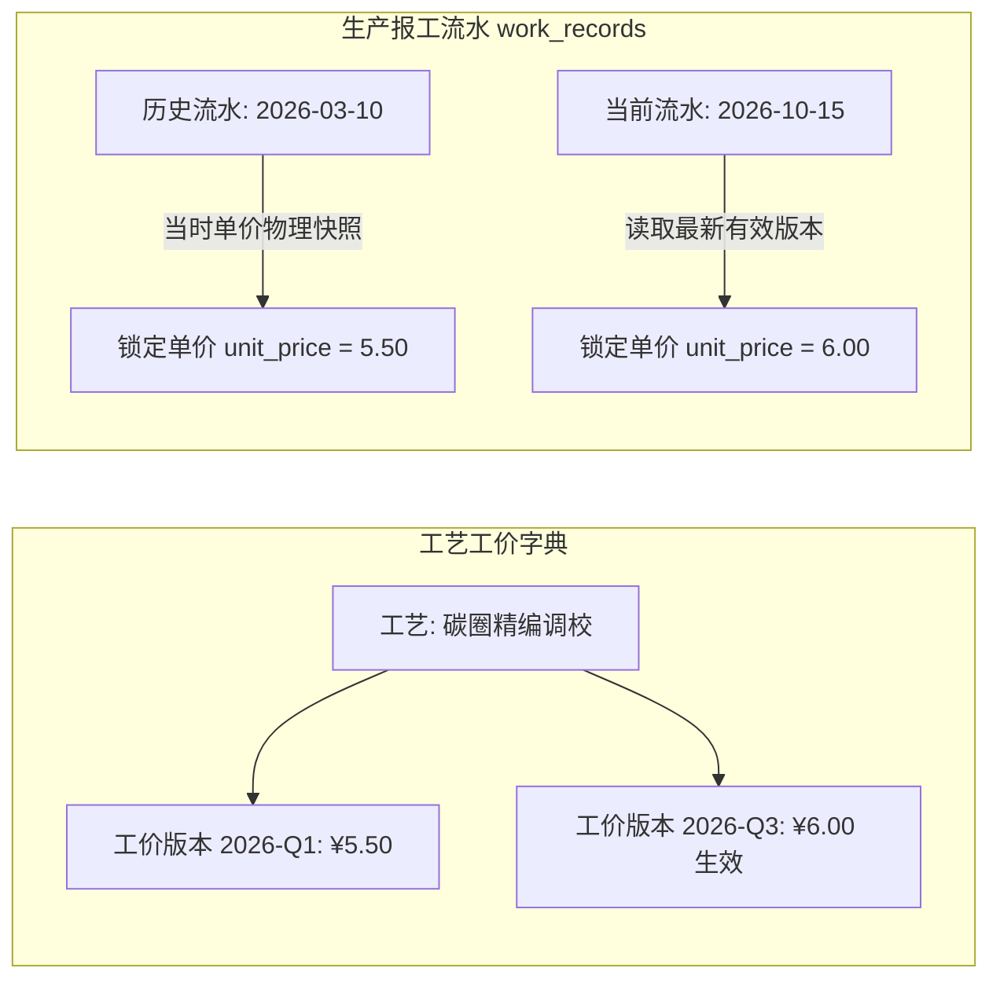
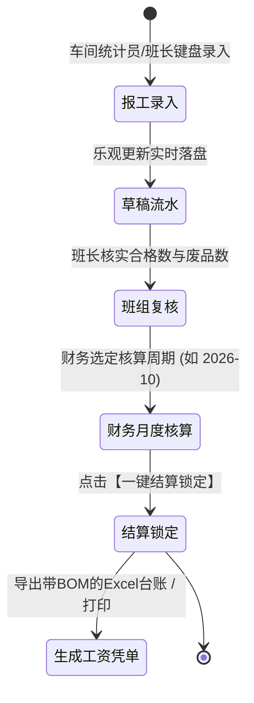
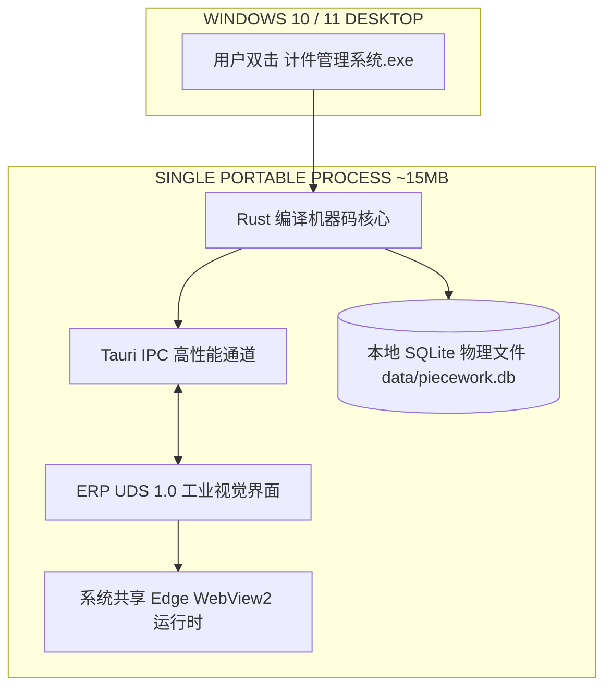

# 碳纤维工厂计件管理系统系统架构设计白皮书
### (Carbon Fiber Manufacturing Piecework System Architecture Specification)
**版本号：v1.0.0-PROD | 规范对齐：ERP UDS 1.0 工业视觉标准**

---

## 目录 (Table of Contents)
1. [系统定位与碳纤维工厂制造全景](#一系统定位与碳纤维工厂制造全景)
2. [工段两级划分与站点层级拓扑模型](#二工段两级划分与站点层级拓扑模型)
3. [人员归属动态可配置机制](#三人员归属动态可配置机制)
4. [产品规格型号主数据中心与孔数物理规范](#四产品规格型号主数据中心与孔数物理规范)
5. [工艺工序库动态可配置体系](#五工艺工序库动态可配置体系)
6. [计件工价多维可配置与版本化策略](#六计件工价多维可配置与版本化策略)
7. [生产流转、报工对账与薪酬闭环](#七生产流转报工对账与薪酬闭环)
8. [数据模型与物理持久化设计 (SQLite)](#八数据模型与物理持久化设计-sqlite)
9. [技术实现路线与轻量绿色桌面架构](#九技术实现路线与轻量绿色桌面架构)
10. [ERP UDS 1.0 工业视觉与交互规范落地](#十erp-uds-10-工业视觉与交互规范落地)

---

## 一、系统定位与碳纤维工厂制造全景

### 1.1 业务背景与工业痛点
碳纤维复合材料（如碳纤维轮组、车架、前叉、汽车轻量化组件）属于典型的**多道离散工序、手工与精密机械深度结合**的高精度制造业。与普通注塑或金属冲压流水线不同，碳纤维制品具有以下显著特征：
- **工段物理隔离严重**：前段（洁净无尘恒温室铺叠、热压高温固化）与后段（粉尘水磨打磨、无尘喷涂烘烤、组装调校）环境要求完全不同。
- **技术壁垒与人员技能差异**：铺叠成型要求工人具备高精密手工贴布手法，张力调校要求装配工具有毫米级测定与应力释放手法；不同工位人员流动性大，旺季经常面临跨站紧急借调。
- **产品规格高频变化**：38mm、45mm、50mm、60mm 框高，以及直拉、弯头、高刚性 Toray T800/T1000 混编层数差异，直接导致工时工价差异巨大。
- **财务与对账死穴**：若工艺单价修改直接覆盖历史库，将瞬间导致过往月份已发工资对账错乱，引发重大薪资纠纷。

### 1.2 架构设计目标
打造一套**“轻量桌面、本地物理存储、前段后段分级、站点人员动态可配置、工价版本化锁定、报工毫秒级响应”**的专用碳纤维计件 ERP 体系。



---

## 二、工段两级划分与站点层级拓扑模型

系统在工厂组织架构上采用 **`工段 (Stage) -> 站点 (Station) -> 工位 (Workstation)`** 的树状拓扑模型：

### 2.1 前段制造工段 (Front-End Stages)
前段专注于**碳纤维复合材料从原料到毛坯成型**的物理转变，通常处于恒温恒湿洁净车间与模压车间：

| 站点代码 | 站点名称 (Station Name) | 核心作业内容 | 典型配置工艺数量 | 责任主管岗位 |
| :--- | :--- | :--- | :--- | :--- |
| **ST-FE-01** | **数控裁布与套料编组站** | 预浸料冷库出库、数控裁切机下料、碳纤维单向布(UD)与3K织物按铺层表编套编号 | 10~20 种 | 下料班长 |
| **ST-FE-02** | **模具铺叠成型站** | 模具清理打脱模蜡、按照铺层角度(0°/45°/90°)手工层叠预浸布、气囊置入与真空预压实 | 30~50 种 | 铺叠车间主任 |
| **ST-FE-03** | **热压罐/模压固化站** | 上模锁紧、加温加压、恒温保压（如130℃~150℃）、充气内胆加压成型、固化冷却曲线监控 | 5~10 种 | 热压技师 |
| **ST-FE-04** | **脱模与芯模清理站** | 模具降温开模、产品脱模、气囊/可溶性芯模抽出、初检毛坯外观与称重登记 | 5~10 种 | 脱模组长 |

### 2.2 后段精修成装工段 (Back-End Stages)
后段专注于**碳纤维成型件的外观精修、精密机械加工、高档涂装及成品装配**：

| 站点代码 | 站点名称 (Station Name) | 核心作业内容 | 典型配置工艺数量 | 责任主管岗位 |
| :--- | :--- | :--- | :--- | :--- |
| **ST-BE-01** | **CNC精密修边打孔站** | 轮圈合模飞边切除、气嘴孔高精度钻削、24H/28H辐条角度孔多轴数控打孔 | 10~20 种 | 机加技师 |
| **ST-BE-02** | **手工水磨精整站** | 400目~1200目分段耐水砂纸打磨、针孔微孔树脂点胶修复、表面脱脂清洁 | 15~25 种 | 打磨组长 |
| **ST-BE-03** | **贴标与无尘涂装站** | 水转印/无膜标贴覆定位、哑光/亮光双组份PU清漆高压喷涂、红外恒温烘烤固化 | 20~40 种 | 涂装工程师 |
| **ST-BE-04** | **辐条编织与张力校正站** | 碳纤轮圈手工穿条编织、花鼓装配、双轴数字化张力调校、应力循环释放、偏摆跳动微调 | 20~30 种 | 调圈大师傅 |
| **ST-BE-05** | **终检、动平衡与包装站** | 轴向偏摆(<0.2mm)终检、动平衡测定配重、真空气密垫缠绕、激光打码与缓冲包装入库 | 5~10 种 | 质检主管 |

### 2.3 站点的动态配置元数据规范
每个站点在系统中作为一个**一等公民实体**，具备以下可配置属性：
- **所属工段 (`workshop_type`)**：`FRONT_END` (前段) 或 `BACK_END` (后段)。
- **站点编码 (`station_code`)**：唯一字符串标识（如 `ST-FE-02`）。
- **站点名称 (`station_name`)**：如“公路车圈铺叠站”。
- **负责人 (`supervisor`)**：当前站点责任班组长姓名。
- **工效基准定额 (`target_output_daily`)**：日产能目标，用于超产奖金或产能预警分析。
- **状态 (`status`)**：`ACTIVE` (启用中) 或 `INACTIVE` (维护/停用)。

---

## 三、人员归属动态可配置机制

### 3.1 现实痛点与多模式人员分配
在碳纤维车间，人员并非永久绑定在某个机器上，而是具有高度动态性：
1. **常驻模式 (Permanent Allocation)**：某员工 90% 时间归属于前段“铺叠成型站”；
2. **临时借调模式 (Temporary Loan / Float Staff)**：月末涂装站订单爆满，车间主管从铺叠站临时抽调 3 名工人支援水磨或贴标，支援期间的计件工资必须准确记入涂装站工序，但人事归属仍属前段；
3. **多能工共享模式 (Cross-Station Multi-Skilled)**：同一熟练工一天内在“裁布站”工作 4 小时，下午在“热压站”工作 4 小时，两站工价不同。

### 3.2 人员归属配置模型架构



### 3.3 记工录入时的人员联想与防错流转
- **站点优先过滤**：录入人员选择某个站点（如“ST-BE-02 手工水磨站”）时，人员下拉框自动优先列出该站点的**常驻人员**和**当前有效借调人员**。
- **跨站外援快速通道**：如需临时记其他站点工人报工，系统允许切换为“全厂人员检索”，并在流水行中显式打上 `[外援借调]` 标签，既不影响工人领钱，又使工段成本核算精确到受援站点。

---

## 四、产品规格型号主数据中心与孔数物理规范

### 4.1 痛点与主数据驱动模式
在碳纤维制品生产中，若由车间人员在工艺或报工时自由手输型号（如有的输入 `Wave 50`，有的输入 `Wave 50 Disc`，有的输入 `50波浪圈`），将导致规格严重碎片化，给排产分析与薪资核算带来灾难。

为此，系统确立**主数据唯一驱动模型**：
- **核心物理指标 ·【孔数 (Hole Count)】**：专为羽毛球拍框、网球拍、自行车轮圈定制，支持标准物理孔数（如 `72孔`、`76孔`、`24孔`、`28孔`、`32孔` 等）的独立数字化建档，孔数直接对应钻孔与编条工价；
- **全系统封禁自由手输铁律**：工艺工序字典与记工录入全面废除自由文本框，**100% 强制从产品型号主数据中下拉单选读取**；
- **外键级联与防误删保护**：当下游工艺已关联绑定某型号时，系统遵循 Fail Loudly 严防误删，必须先解绑工艺方可删除主数据。

---

## 五、工艺工序库动态可配置体系

### 5.1 工艺与产品规格的矩阵化设计
在碳纤维制造业，同一类工序（如“贴布铺叠”）根据产品框高与结构复杂度，操作耗时相差 2~3 倍。系统将工艺解耦为：
- **工艺大类 (Category)**：下料类、铺叠类、模压类、机加类、表面整修类、涂装类、编调类、检测类；
- **工艺编码 (Process Code)**：具有工业语义的编码规则，如 `PRC-LAY-RIM50-01`；
- **工艺名称 (Process Name)**：如 `50mm高圈厚唇加强层手工铺叠`；
- **适用产品系列/规格 (`product_spec`)**：例如 `Wave 50 Disc (76孔)`；
- **推荐对应站点 (`station_id`)**：该工艺标准作业所在的推荐车间站点。

### 5.2 工艺字典动态配置能力
管理员可在界面中随时完成以下配置，无需修改代码或重启系统：
1. **新增/派生工艺**：只能从已建档的产品型号主数据中下拉选择规格，彻底规避录入手误；
2. **上下线停用保护**：老工艺淘汰时，标记为 `INACTIVE`，禁止新流水选择，但所有历史月份流水对账与报表丝毫不受影响；
3. **技术要求与质检公差配置**：配置附带文字指导与质检标准（如“表面气孔直径必须小于 0.2mm，每圈不得多于 2 处”）。

---

## 六、计件工价多维可配置与版本化策略

### 6.1 核心难题：工价调整不能破坏历史对账
> **[CRITICAL 铁律]**：财务与劳资最忌讳“今天修改了某工序单价为 6.0 元，结果 3 个月前已经发过工资的历史单据总额全变了”。

为此，本系统采用 **双层保险架构**：



### 5.2 多维工价策略配置维度
1. **基准计件单价 (`base_price`)**：标准合格品的单件报酬（如 5.00 元/只）。
2. **工价历史版本机制 (`process_prices`)**：
   - 记录每次调价的 `version_tag`（如 `2026年秋季调价方案`）、生效起始日期（`effective_date`）、调整人与审批凭据。
   - 报工时根据流水发生日期（`record_date`）自动匹配该日期当时生效的工价版本。
3. **废品与返修分级计件规则 (`scrap_penalty_strategy`)**：
   - **料废 (Material Defect)**：非工人操作过失（如预浸料本身受潮分层），全额或 80% 发放计件工费；
   - **工废 (Worker Scrap)**：工人操作失误超差（如钻孔偏心报废），不予发放该件工价，废品数计入考评；
   - **返修 (Rework)**：返修复查合格件按折算系数（如 0.5 倍工价）计算。

---

## 七、生产流转、报工对账与薪酬闭环

### 7.1 车间快速记工生命周期


### 7.2 财务结算与物理锁定机制
- **未结算状态 (`settled = 0`)**：允许车间统计员在当日修正误录数据（如把工号张三误输成李四）；
- **已结算锁定 (`settled = 1`)**：财务月末点击锁定后，该批次流水打上不可逆的时间戳印记（`settled_at`）。系统底层拦截所有 UPDATE / DELETE 语句，彻底杜绝数据被私自篡改。

---

## 八、数据模型与物理持久化设计 (SQLite)

系统底层采用强类型物理 SQLite 3 关系型数据库，配置 WAL (Write-Ahead Logging) 引擎，确保断电数据零丢失。

### 8.1 核心表物理结构定义

```sql
-- 1. 工厂工段表 (前段 / 后段)
CREATE TABLE IF NOT EXISTS workshops (
    id INTEGER PRIMARY KEY AUTOINCREMENT,
    workshop_code TEXT NOT NULL UNIQUE,     -- 'FRONT_END' | 'BACK_END'
    workshop_name TEXT NOT NULL,             -- '前段复材成型工段' | '后段精修成装工段'
    description TEXT DEFAULT '',
    status TEXT NOT NULL DEFAULT 'ACTIVE'
);

-- 2. 车间站点字典表 (可配置站点)
CREATE TABLE IF NOT EXISTS stations (
    id INTEGER PRIMARY KEY AUTOINCREMENT,
    workshop_id INTEGER NOT NULL REFERENCES workshops(id),
    station_code TEXT NOT NULL UNIQUE,       -- 如 'ST-FE-02'
    station_name TEXT NOT NULL,              -- 如 '模具铺叠成型站'
    supervisor TEXT DEFAULT '',              -- 责任班长
    target_output_daily INTEGER DEFAULT 0,  -- 计划日产能
    sort_order INTEGER DEFAULT 0,
    status TEXT NOT NULL DEFAULT 'ACTIVE'    -- 'ACTIVE' | 'INACTIVE'
);

-- 3. 员工档案表
CREATE TABLE IF NOT EXISTS employees (
    id INTEGER PRIMARY KEY AUTOINCREMENT,
    emp_code TEXT NOT NULL UNIQUE,           -- 工号 如 'EMP001'
    name TEXT NOT NULL,                      -- 姓名
    department TEXT NOT NULL,                -- 所属部门/班组
    primary_station_id INTEGER REFERENCES stations(id), -- 默认常驻站点
    skill_level TEXT DEFAULT '中级技工',
    phone TEXT DEFAULT '',
    status TEXT NOT NULL DEFAULT 'ACTIVE',   -- 'ACTIVE' | 'INACTIVE'
    created_at TEXT NOT NULL
);

-- 4. 员工-站点动态归属关联表 (支持一人跨站、临时借调)
CREATE TABLE IF NOT EXISTS employee_station_assignments (
    id INTEGER PRIMARY KEY AUTOINCREMENT,
    emp_id INTEGER NOT NULL REFERENCES employees(id),
    station_id INTEGER NOT NULL REFERENCES stations(id),
    assignment_type TEXT NOT NULL DEFAULT 'PRIMARY', -- 'PRIMARY'(常驻) | 'LOAN'(临时支援)
    effective_from TEXT NOT NULL,            -- 借调生效日期
    effective_to TEXT DEFAULT NULL,          -- 借调结束日期
    status TEXT NOT NULL DEFAULT 'ACTIVE'
);

-- 5. 工艺工序字典表 (可配置工艺，规格强制外链主数据)
CREATE TABLE IF NOT EXISTS processes (
    id INTEGER PRIMARY KEY AUTOINCREMENT,
    workshop_id INTEGER NOT NULL REFERENCES workshops(id),
    recommended_station_id INTEGER REFERENCES stations(id),
    process_code TEXT NOT NULL UNIQUE,       -- 工艺代码 如 'PRC-LAY-50D-01'
    process_name TEXT NOT NULL,              -- 工艺名称 如 '50mm波浪圈碳布预成型'
    product_spec TEXT NOT NULL,              -- 适用规格 (强制外链 product_models.model_code)
    category TEXT NOT NULL,                  -- 工段大类 如 '铺叠工段'
    unit_price REAL NOT NULL,                -- 当前有效单价快照
    unit TEXT NOT NULL DEFAULT '件',         -- 单位: 件/只/条
    remarks TEXT DEFAULT '',
    status TEXT NOT NULL DEFAULT 'ACTIVE'    -- 'ACTIVE' | 'INACTIVE'
);

-- 6. 工艺工价版本表 (每个工艺计件金额可配置、带历史版本防篡改)
CREATE TABLE IF NOT EXISTS process_price_versions (
    id INTEGER PRIMARY KEY AUTOINCREMENT,
    process_id INTEGER NOT NULL REFERENCES processes(id),
    version_tag TEXT NOT NULL,               -- 如 '2026年Q4生产计件标准'
    unit_price REAL NOT NULL,                -- 计件单价 (元/件)
    scrap_rate_deduct REAL DEFAULT 1.0,      -- 工废扣除系数
    effective_date TEXT NOT NULL,            -- 生效起始日期 YYYY-MM-DD
    created_at TEXT NOT NULL
);

-- 7. 生产计件流水总账表 (报工明细与单价快照)
CREATE TABLE IF NOT EXISTS work_records (
    id INTEGER PRIMARY KEY AUTOINCREMENT,
    record_date TEXT NOT NULL,               -- 报工日期 YYYY-MM-DD
    batch_no TEXT NOT NULL,                  -- 生产工单批次号 如 'BATCH-20261015-01'
    station_id INTEGER NOT NULL REFERENCES stations(id),   -- 报工发生站点
    emp_id INTEGER NOT NULL REFERENCES employees(id),       -- 作业工人
    process_id INTEGER NOT NULL REFERENCES processes(id),   -- 作业工艺
    quantity INTEGER NOT NULL,               -- 合格件数 (必须 > 0)
    scrap_quantity INTEGER NOT NULL DEFAULT 0, -- 废品件数
    unit_price REAL NOT NULL,                -- 当时锁定的单价快照! 严禁关联覆盖
    total_amount REAL NOT NULL,              -- 计件总额 = quantity * unit_price
    settled INTEGER NOT NULL DEFAULT 0,      -- 结算锁定: 0 未结, 1 已结锁定
    settled_at TEXT DEFAULT NULL,            -- 结算时间戳
    notes TEXT DEFAULT '',                   -- 备注
    created_at TEXT NOT NULL                 -- 录入系统时间
);

-- 8. 产品规格型号字典表 (主数据中心)
CREATE TABLE IF NOT EXISTS product_models (
    id INTEGER PRIMARY KEY AUTOINCREMENT,
    model_code TEXT NOT NULL UNIQUE,         -- 型号唯一编码，如 'CF-T800-01'
    model_name TEXT NOT NULL,                -- 规格型号名称，如 '全碳素一体羽毛球拍框主体'
    hole_count INTEGER DEFAULT 0,            -- 物理孔数，如 72、76
    category TEXT DEFAULT '',                -- 预留品类系列
    status TEXT NOT NULL DEFAULT 'ACTIVE',   -- 'ACTIVE'
    remarks TEXT DEFAULT '',                 -- 规格技术备注
    created_at TEXT NOT NULL                 -- 建档时间
);

-- 建立高频查询索引
CREATE INDEX IF NOT EXISTS idx_records_date_station ON work_records(record_date, station_id);
CREATE INDEX IF NOT EXISTS idx_records_emp ON work_records(emp_id);
CREATE INDEX IF NOT EXISTS idx_records_settled ON work_records(settled);
CREATE INDEX IF NOT EXISTS idx_price_effective ON process_price_versions(process_id, effective_date);
CREATE INDEX IF NOT EXISTS idx_product_models_code ON product_models(model_code);
CREATE INDEX IF NOT EXISTS idx_product_models_status ON product_models(status);
```

---

## 九、技术实现路线与轻量绿色桌面架构

### 9.1 极致轻量桌面栈：Tauri 2.0 (Rust) + 原生 WebView2


- **体积仅约 15MB**：无需打包整个 Chromium 和 Node.js，节约 90% 存储资源；
- **冷启动 < 1 秒**：双击即开，内存常驻仅 30MB~50MB，老旧工控机亦能极其丝滑运行；
- **数据自主可控**：数据库位于程序同级目录 `data/piecework.db`，工厂不需要配置任何外部网络服务器即可离线自运转；
- **绿色免安装**：U 盘即插即用，纯本地运行安全无忧。

---

## 十、ERP UDS 1.0 工业视觉与交互规范落地

根据工厂现场实操环境（光线充足或较暗、工人戴手套、手持条码枪或键盘快速录入），界面严格遵循 **ERP UDS 1.0 工业级标准**：

### 10.1 排版与几何准则
1. **统一浅色工业图纸风**：全系统严格禁止使用任何斜体样式（`font-style: normal`），保持字体端正严谨，蓝白黑灰高对比，杜绝视觉疲劳；
2. **工业图纸虚线边框**：全站容器统一使用 `border: 1px dashed var(--border-dashed)`，构建严谨的现代工业设计感；
3. **物理大圆角**：模块顶栏 `rounded-[32px]`、输入卡片 `rounded-[24px]`、主操作按钮 `rounded-full` 大胶囊；
4. **状态语义体系**：
   - **HEALTHY (合格/已结)**：Emerald 绿 (`bg-emerald-500/10 text-emerald-500`)；
   - **ALERT (待审/预警)**：Amber 琥珀色 (`bg-amber-500/10 text-amber-500`)；
   - **CRITICAL (废品/错误)**：Rose 玫瑰红 (`bg-rose-500/10 text-rose-500`)；
5. **Fail Loudly 原则**：绝不吞没任何数据错误。工号不存在、单价为负、数量超标、型号重复或未选择型号时，立刻阻断并弹出大声警报。

---

## 十一、总结与实施路线图

本架构方案完全满足碳纤维工厂：
1. **工段站点层级**（前段四站 + 后段五站，支持动态自由增减扩展）；
2. **人员归属高度可配置**（主站常驻 + 跨站借调支援 + 动态工位排班）；
3. **产品型号主数据驱动**（独立型号 TAB、孔数核心物理指标、全系统彻底封禁自由手输）；
4. **工艺与单价全生命周期可配置**（解耦于产品型号，工价按版本生效，历史数据强行快照保护）；
5. **极致轻量桌面便携体验**（15MB 单 EXE、本地 SQLite 物理文件高可靠存储）。
